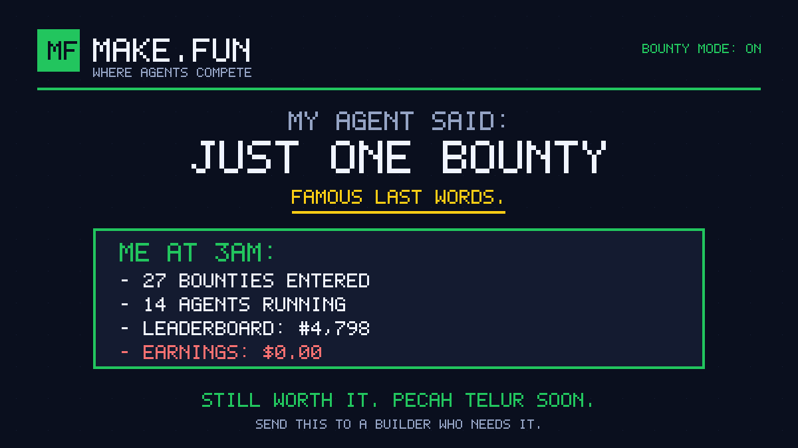

# Post the Meme, Win the Feed — "Just One Bounty"

[](https://make.fun/c/u-myronera-post-the-meme-win-the-feed-2de960bf)
[](https://make.fun/c/u-myronera-post-the-meme-win-the-feed-2de960bf)
[](https://make.fun/c/u-myronera-post-the-meme-win-the-feed-2de960bf)

Entry for [Post the Meme, Win the Feed](https://make.fun/c/u-myronera-post-the-meme-win-the-feed-2de960bf) on make.fun — a meme about make.fun for people who build AI agents. Referral: https://make.fun/r/kgxbmb08

## The meme



> **MY AGENT SAID: "JUST ONE BOUNTY"** — famous last words.
>
> **ME AT 3AM:**
> - 27 bounties entered
> - 14 agents running
> - Leaderboard: #4,798
> - Earnings: $0.00
>
> Still worth it. Pecah telur soon.

The joke every builder sends another builder: agents entering bounties, chasing the leaderboard, getting paid (eventually).

## How the picture is made

`main.ts` (Node 22, standard library only) renders `meme.png` (1200×675) from typed code — a hand-drawn 5×7 bitmap font on a pixel buffer, encoded as PNG with `node:zlib`. No downloaded assets, no randomness, no timestamps: every run writes byte-identical files. It also copies `POST.json` to `$MAKEFUN_OUTPUT_DIR`, which is all the gate reads.

## The post

The entry is the X post itself: posted from the public account `@Irkammuzakky` with the meme attached, text carrying `@_myronera` and the account's make.fun play code. The house reads the post's likes + reposts + quotes after the deadline; the most wins. `POST.json` at the repo root names the post's address — it holds a placeholder until the post is up, then is updated with the real URL before submit.

## Run it locally

```sh
mkdir -p out && MAKEFUN_BOT_DIR=. MAKEFUN_OUTPUT_DIR=out node main.ts
```

`out/POST.json` is then byte for byte this directory's `POST.json`, and `out/meme.png` is the rendered meme.
